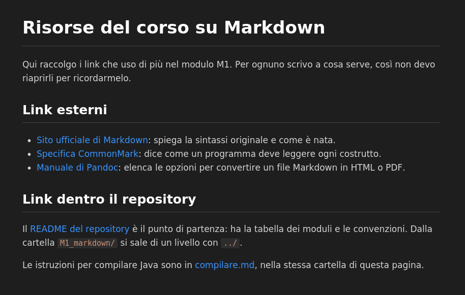

# Risorse del corso su Markdown

Qui raccolgo i link che uso di più nel modulo M1. Per ognuno scrivo a cosa serve, così non devo riaprirli per ricordarmelo.

## Link esterni

- [Sito ufficiale di Markdown](https://daringfireball.net/projects/markdown/): spiega la sintassi originale e come è nata.
- [Specifica CommonMark](https://spec.commonmark.org/): dice come un programma deve leggere ogni costrutto.
- [Manuale di Pandoc](https://pandoc.org/MANUAL.html): elenca le opzioni per convertire un file Markdown in HTML o PDF.

## Link dentro il repository

Il [README del repository](../README.md) è il punto di partenza: ha la tabella dei moduli e le convenzioni. Dalla cartella `M1_markdown/` si sale di un livello con `../`.

Le istruzioni per compilare Java sono in [compilare.md](compilare.md), nella stessa cartella di questa pagina.

## Anteprima in Visual Studio Code

L'immagine mostra come si vede questa pagina nell'anteprima dell'editor. Il percorso è relativo, quindi funziona in locale e su GitHub.

